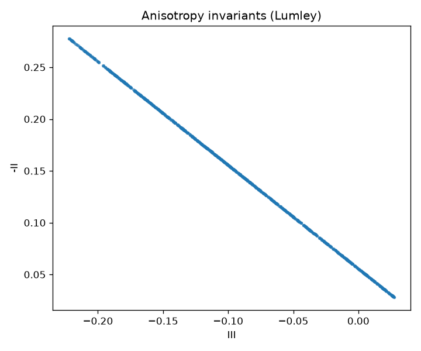

# Anisotropy

Anisotropy tensor, invariants, and barycentric map.

```python
from pivpy import io

ds = io.create_sample_Dataset(n_frames=4, rows=12, cols=12)
inv = ds.piv.anisotropy_invariants()
```

```python
from pivpy.graphics import anisotropy_disp

fig, ax = anisotropy_disp(inv)
```


