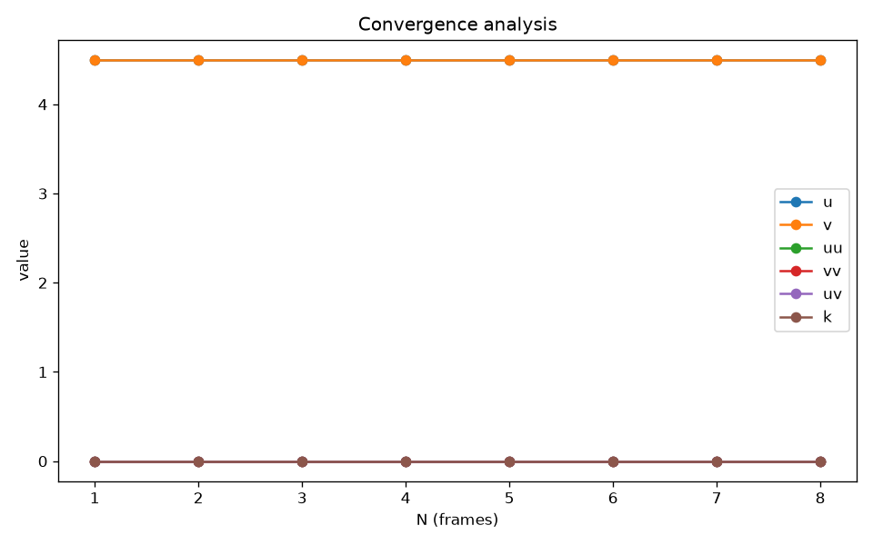

# Convergence analysis

Estimate how many frames are needed for turbulence statistics to converge.

```python
from pivpy import io
ds = io.create_sample_Dataset(n_frames=8, rows=8, cols=8)
conv = ds.piv.convergence()
```

```python
from pivpy.graphics import convergence_disp
fig, ax = convergence_disp(conv)
```


