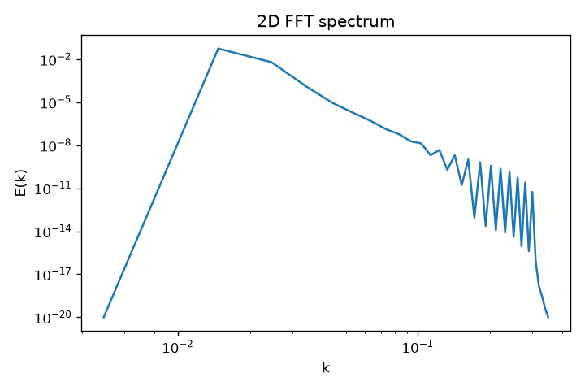

# FFT spectra (2D)

Compute a 2D FFT-based spatial spectrum.

```python
from pivpy import io
ds = io.create_sample_Dataset(n_frames=2, rows=32, cols=32)
spec = ds.piv.fft_spectrum(component="u")
```

```python
from pivpy.graphics import fft_spectrum_disp
fig, ax = fft_spectrum_disp(spec)
```


