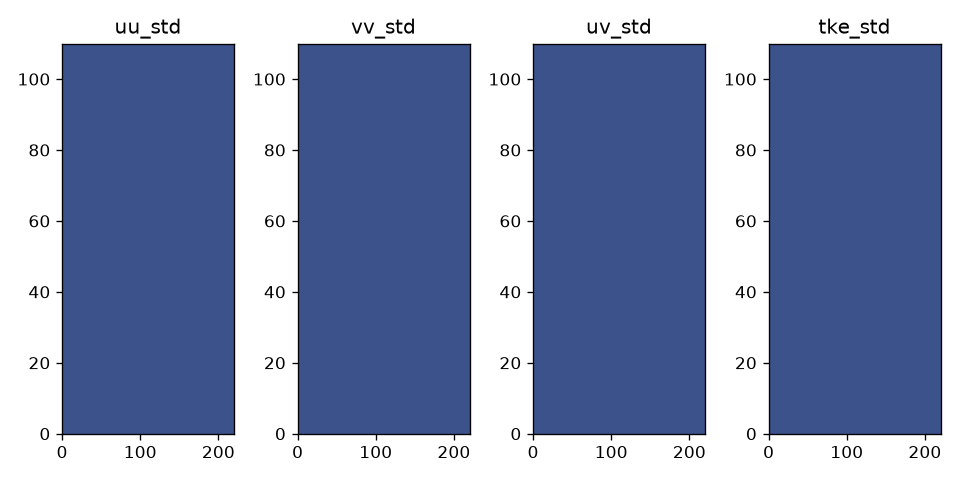

# Stress and TKE variants

Standard deviations of Reynolds stresses/TKE and line profiles.

```python
from pivpy import io
ds = io.create_sample_Dataset(n_frames=4, rows=12, cols=12)
std = ds.piv.reynolds_stress_std()
lp = ds.piv.stress_line_profile(0, 0, 1, 1, component="uu")
```

```python
from pivpy.graphics import stress_std_disp
fig, axes = stress_std_disp(std)
```


