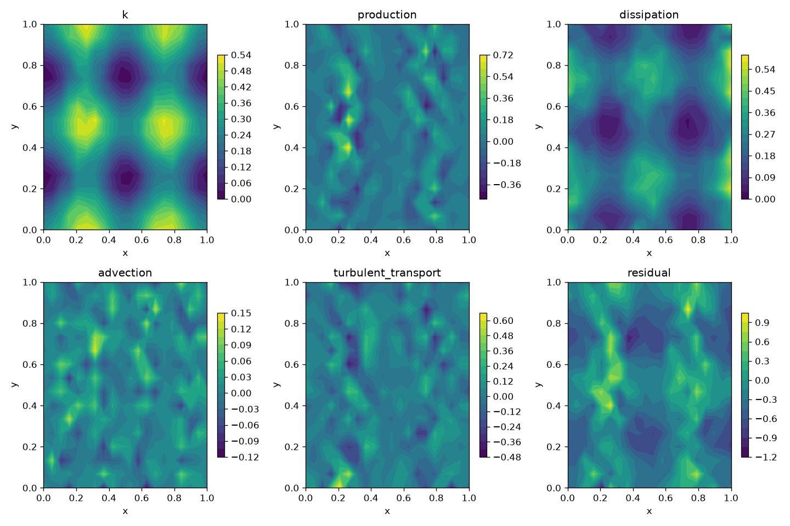

# TKE budget

Compute the terms of the turbulent kinetic energy (TKE) budget on a multi-frame PIV
dataset: `k`, `production`, `dissipation`, `advection`, `turbulent_transport`,
`viscous_diffusion`, and `residual`.

```python
from pivpy import io

ds = io.create_sample_Dataset(n_frames=6, rows=16, cols=16)
budget = ds.piv.tke_budget(nu=1e-3)
```

Plot all terms:

```python
from pivpy.graphics import tke_budget_disp

fig, axes = tke_budget_disp(budget)
```


