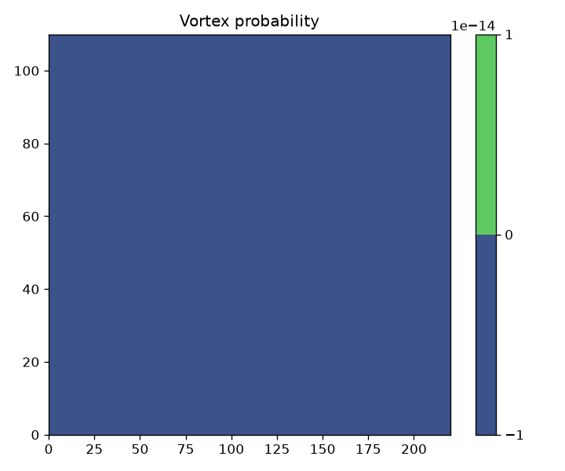

# Vortex identification

Detect vortices and compute spatial vortex probability.

```python
from pivpy import io
ds = io.create_sample_Dataset(n_frames=4, rows=12, cols=12)
vs = ds.piv.detect_vortices(criterion="gamma2", threshold=0.1)
prob = ds.piv.vortex_probability(threshold=0.1)
```

```python
from pivpy.graphics import vortex_disp
fig, ax = vortex_disp(prob, vs)
```


